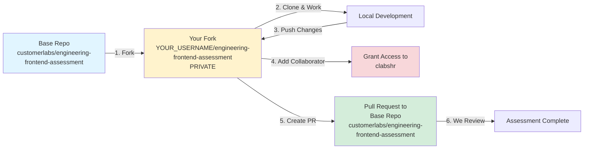

# Action Recorder Widget - Frontend Assessment

## Assessment Overview

Welcome to the **Frontend Engineer Assessment**. This is a hands-on coding challenge designed to evaluate your proficiency in React.js, JavaScript, HTML, CSS, and API integration.

| Detail | Information |
|--------|-------------|
| **Position** | Frontend Engineer (2+ years experience) |
| **Time Limit** | 4 hours maximum |
| **Difficulty** |  Beginner to Intermediate |

---

## ⚠️ CRITICAL: REPOSITORY CONFIDENTIALITY

**🚨 READ THIS CAREFULLY BEFORE PROCEEDING 🚨**

### This is CustomerLabs Proprietary Assessment Material

**IMPORTANT REQUIREMENTS:**

1. **📌 Fork this PRIVATE repository** - Do NOT make it public
2. **🔒 Keep your fork PRIVATE** at all times during and after the assessment
3. **✅ Grant access to `clabshr` user** on GitHub when submitting
4. **❌ NEVER push this code to any public repository**
5. **❌ NEVER share this code with anyone outside this assessment**

**Step-by-Step Workflow:**

```text
1. Fork: customerlabs/engineering-frontend-assessment → YOUR_USERNAME/engineering-frontend-assessment (PRIVATE)
2. Complete your assessment in your fork
3. Grant access to GitHub user: clabshr (REQUIRED)
4. Create Pull Request from your fork → customerlabs/engineering-frontend-assessment
5. We review your PR and code
```

### ⚠️ Confidentiality Agreement

By proceeding with this assessment, you agree that:

- ✅ This codebase is **CustomerLabs proprietary material**
- ✅ You will **NOT** share this code publicly or with third parties
- ✅ You will **DELETE** your fork after the assessment concludes (if requested)
- ✅ Any violation of confidentiality may result in **legal action**

**This is a serious professional responsibility.** We trust you to maintain confidentiality.

### ❓ Questions About Confidentiality?

If you're unsure about any aspect of these requirements, **please ask us first** before proceeding.

---

## What You're Building

The **Action Recorder Widget** is an embeddable React widget that allows users to configure event tracking on any website. The widget can be embedded on any webpage and is controlled via URL query parameters.

Your task is to complete the implementation by filling in the `TODO` sections throughout the codebase. The TODOs are clearly marked with task numbers and point values.

### Widget Features

- Draggable widget positioning on the page
- Minimize/maximize functionality
- Event list display with search and pagination
- Event form for creating and editing events
- API integration for persisting event configurations
- LocalStorage persistence for widget state

---

## Quick Start

### 1. Install Dependencies

```bash
npm install
```

### 2. Build the Widget

```bash
npm run build:dev
```

This builds the widget and watches for changes.

### 3. Start the Test Server

In a separate terminal:

```bash
cd backend-server
npm install
npm start
```

The server runs at `http://localhost:3000`

### 4. Test the Widget

Open your browser and navigate to:

```
http://localhost:3000?cl_widget=define
```

The widget should appear in the bottom-right corner of the page.

### Query Parameters

| Parameter | Value | Effect |
|-----------|-------|--------|
| `cl_widget` | `define` | Show the widget |
| `cl_widget` | `track` | Hide the widget |

---

## Project Structure

```
src/
├── index.js              # Widget entry point (mounts React app)
├── loader.js             # Widget loader (query param logic, localStorage)
├── App.jsx               # Root React component
├── components/           # UI Components
│   ├── Widget/           # Main widget container
│   ├── Header/           # Header with controls
│   ├── EventTable/       # Event list table
│   ├── EventForm/        # Event create/edit form
│   ├── SearchBox/        # Search input
│   ├── Pagination/       # Pagination controls
│   └── Button/           # Reusable button
├── hooks/                # Custom React hooks
│   ├── useDraggable.js   # Drag functionality
│   ├── useMinimize.js    # Minimize/maximize state
│   └── useEventData.js   # Event data management
├── utils/                # Utility functions
│   ├── api.js            # API communication
│   └── elementPicker.js  # DOM element selection
└── styles/               # Global styles
    └── global.css

build/                    # Compiled output (generated)
backend-server/           # Test API server
webpack.config.js         # Build configuration
```

---

## Scoring Overview

Your submission will be evaluated across five categories:

| Category | Weight | Focus Areas |
|----------|--------|-------------|
| **React.js** | 43.5% | State management, hooks, component architecture, memoization |
| **JavaScript** | 43.5% | DOM manipulation, async/await, data transformation, webpack config |
| **CSS** | 8.7% | Styling, animations, hover states, transitions |
| **HTML** | 2.2% | Semantic markup, accessibility |
| **API** | 2.2% | Fetch wrapper, error handling, request/response handling |


### Code Quality Considerations

Evaluators will also consider:

- Clean, readable code structure
- Meaningful comments and documentation
- Consistent formatting and naming conventions
- Proper error handling
- No memory leaks (cleanup in effects)

---

## Finding the TODOs

All tasks are marked with `TODO` comments throughout the codebase. Each TODO includes:

- **Task number** (e.g., Task 1, Task 2)
- **Point value** (e.g., 8pts, 5pts)
- **Clear instructions** on what to implement
- **Hints and examples** where helpful

### Example TODO Format

```javascript
// ============================================================================
// TODO (Task 1 - 8pts): Initialize component state
// ============================================================================
// Required states using useState:
// - isMoveMode (boolean, default: false)
// - searchQuery (string, default: '')
// ...
```

---

## Important Notes

1. **Read First**: Review the entire codebase before coding. Understanding the architecture will save time.

2. **ES5 Compatibility**: The codebase uses ES5 syntax (`var`, `function`) in some places for compatibility. Follow the existing patterns.

3. **Build Errors**: Run `npm run build:dev` frequently to catch errors early.

4. **Test Incrementally**: Test each feature as you complete it, don't wait until the end.

5. **Prioritize Working Code**: A partially complete but working solution scores better than a broken complete one.

---

## Detailed Instructions

For comprehensive step-by-step guidance on approaching this assessment, see:

**[ASSESSMENT_GUIDE.md](./ASSESSMENT_GUIDE.md)**

This guide includes:
- Recommended approach and workflow
- Understanding the codebase architecture
- Detailed task breakdown by category
- Tips for success

---

## Tech Stack

- **React 19** - UI library
- **Webpack 5** - Bundler
- **Babel** - ES6+ to ES5 transpilation
- **CSS Modules** - Scoped styling

---

## Need Help?

If you encounter technical issues (not related to the assessment tasks):

1. Check that all dependencies are installed (`npm install`)
2. Ensure the backend server is running
3. Check browser console for errors
4. Verify the build completed successfully

---

## 📤 Submission

### Step-by-Step Submission Process



#### **Step 1: Fork the Base Repository** 🍴

```bash
# Go to: https://github.com/customerlabs/engineering-frontend-assessment
# Click "Fork" button
# ⚠️ IMPORTANT: Keep your fork PRIVATE (Settings → Change visibility → Private)
```

Your fork URL will be:

```text
https://github.com/YOUR_USERNAME/engineering-frontend-assessment (PRIVATE)
```

#### **Step 2: Clone and Work on Your Assessment** 💻

```bash
# Clone YOUR fork (not the base repo)
git clone https://github.com/YOUR_USERNAME/engineering-frontend-assessment
cd engineering-frontend-assessment

# Create your working branch
git checkout -b assessment/{your-name}

# Implement the TODO tasks
# Commit regularly with clear, meaningful messages
git add .
git commit -m "Implement widget state management"

# Push to YOUR fork
git push origin assessment/{your-name}
```

#### **Step 3: Document Your Work** 📝

Create `SOLUTION.md` in your repository explaining:

- ✅ What you completed and which TODOs you implemented
- ✅ Design decisions and tradeoffs  
- ✅ Challenges you faced and how you solved them
- ✅ What you'd do with more time
- ✅ Total time spent on the assessment

#### **Step 4: Grant Access to Reviewer** ⚠️ **CRITICAL STEP**

```text
On GitHub (in YOUR fork):
1. Go to: https://github.com/YOUR_USERNAME/engineering-frontend-assessment
2. Click "Settings" tab
3. Click "Collaborators" in left sidebar
4. Click "Add people" button
5. Enter username: clabshr
6. Click "Add clabshr to this repository"
```

**This step is MANDATORY** - we cannot review without access!

#### **Step 5: Create Pull Request to Base Repository** 🔄

```text
On GitHub:
1. Go to YOUR fork: https://github.com/YOUR_USERNAME/engineering-frontend-assessment
2. Click "Contribute" button (or "Pull requests" tab)
3. Click "Open pull request"
4. Ensure the base repository is set correctly:
   
   Base repository: customerlabs/engineering-frontend-assessment
   Base branch: review
   
   Head repository: YOUR_USERNAME/engineering-frontend-assessment
   Compare branch: assessment/{your-name}

5. Title your PR: "Assessment Submission - {Your Name}"
   Example: "Assessment Submission - John Doe"

6. In PR description, include:
   - Total time spent
   - Link to your SOLUTION.md
   - Any special notes for reviewers

7. Click "Create pull request"
```

#### **Step 6: Notify Us** 📧

Send us an email with:

- ✅ Your Pull Request URL
- ✅ Confirmation that `clabshr` has collaborator access
- ✅ Total time spent

### Pre-Submission Checklist

**Before creating your Pull Request, verify:**

- [ ] ✅ Your fork is PRIVATE (not public)
- [ ] ✅ User `clabshr` has been added as collaborator to your fork
- [ ] ✅ All code is committed and pushed to your fork
- [ ] ✅ `SOLUTION.md` is complete and committed

---

## 🔒 Privacy & Data Note

This is a fictional project with no real user data. The challenges mirror real-world CDP problems but are sanitized for assessment purposes.

---

## ⚠️ Final Confidentiality Reminder

**THIS CODEBASE IS CONFIDENTIAL CUSTOMERLABS PROPERTY**

- Keep your fork PRIVATE
- Add `clabshr` user when submitting
- Never share publicly or with others
- Violations may result in legal consequences

We appreciate your professionalism and integrity in maintaining confidentiality.

---

**Good luck! We're excited to see your approach.** 🚀
